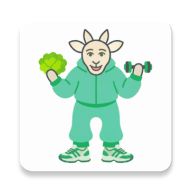
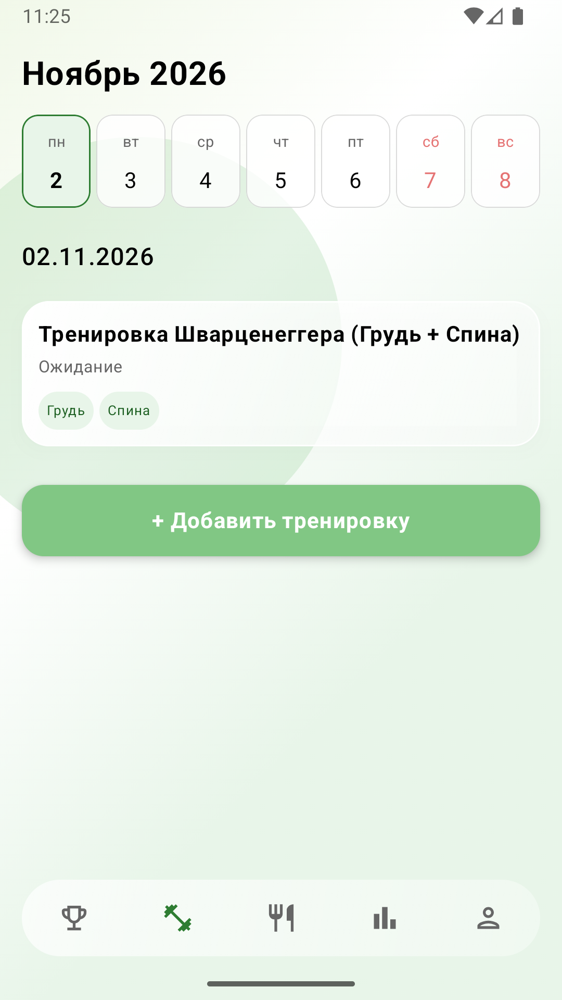
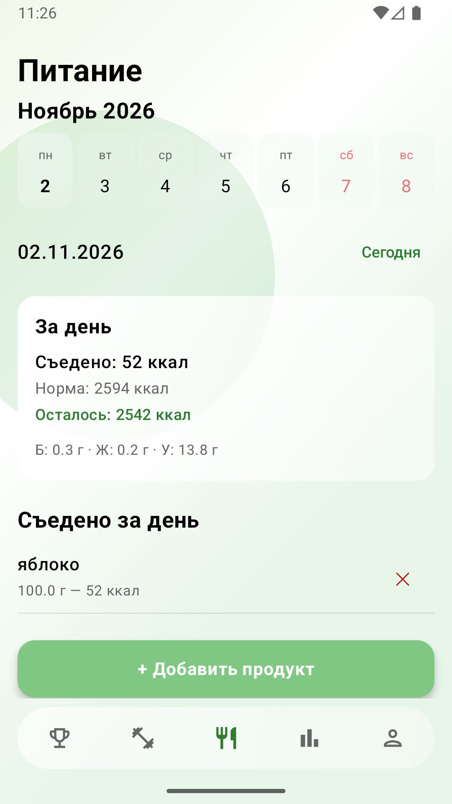
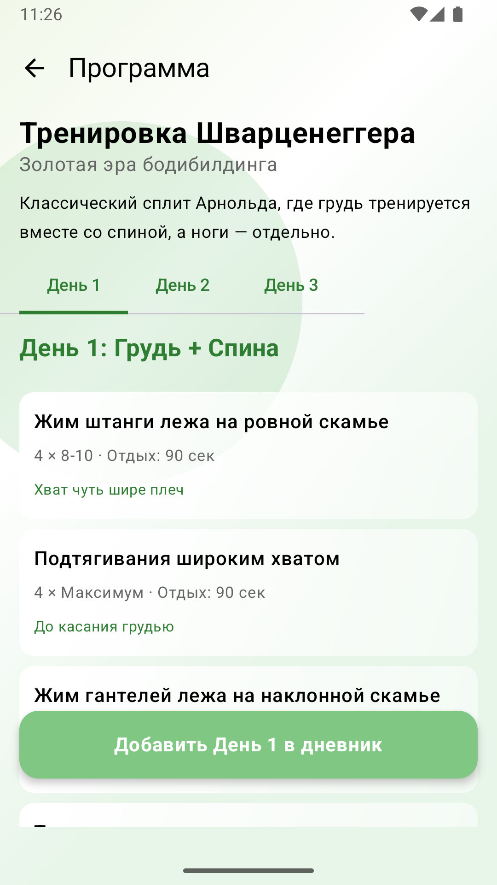
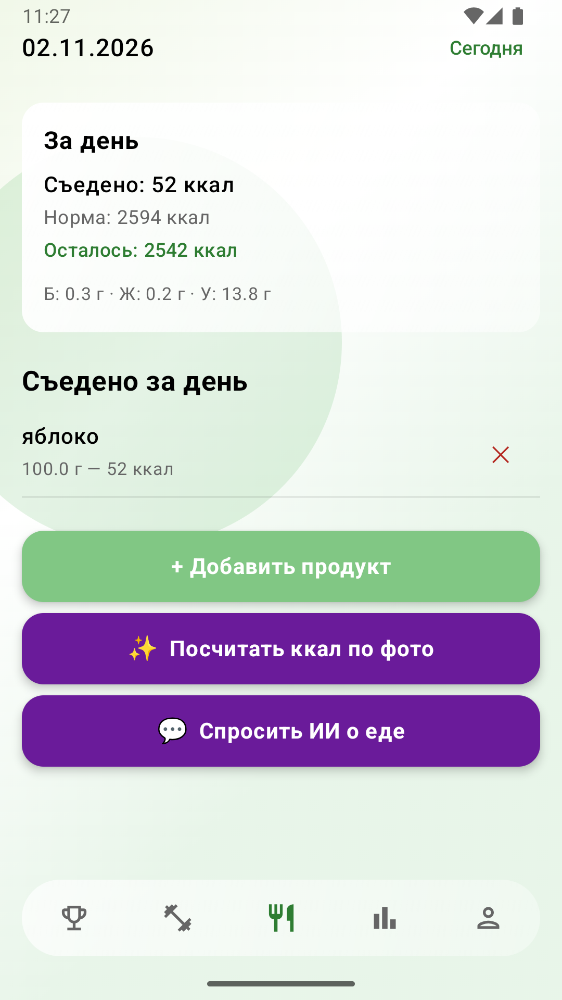

<div align="center">
  
  <h1>FitApp — Персональный фитнес-ассистент</h1>
  <p>Мощное Android-приложение для тренировок и питания с интеграцией нейросетей и умным трекингом.</p>

  <!-- Бейджики технологий -->
  
  
  
  
  
</div>

---

## 📸 Скриншоты приложения

|   Главный экран (Журнал)   |                                     Дневник питания                                     |                                    Экран тренировки                                     |                                    ИИ-распознавание                                     |
|:--------------------------:|:---------------------------------------------------------------------------------------:|:---------------------------------------------------------------------------------------:|:---------------------------------------------------------------------------------------:|
|  |  |  |  |

---

## ✨ Ключевые возможности

### 🥗 Питание
*   **Обширный справочник**: Более 80 базовых продуктов с возможностью добавления своих.
*   **Учёт БЖУ и калорий**: Автоматический подсчёт дневного потребления нутриентов.
*   **Рецепты**: Готовые блюда с автоматическим расчётом КБЖУ на порцию.
*   **Умный дневник**: Разделение записей по дням с помощью удобного календаря.

### 🏋️ Тренировки
*   **Каталог программ**: 10 готовых сплитов и фуллбоди-программ (для новичков и продвинутых).
*   **Справочник упражнений**: Более 300 упражнений с фильтрацией по группам мышц и подкатегориям.
*   **Детальный трекинг**: Запись подходов, веса, повторений и интенсивности (разминка, тяжело и т.д.).
*   **Встроенный таймер**: Отслеживание времени выполнения тренировки в реальном времени.

### 🤖 Искусственный интеллект (GigaChat)
*   **Текстовый запрос**: Достаточно написать «Два яйца и тост», и нейросеть сама рассчитает калории и БЖУ для этого блюда.
*   **Умное редактирование**: Возможность изменить вес порции перед сохранением — калории и нутриенты пересчитаются автоматически.

### 📊 Аналитика и Здоровье
*   **Журнал**: Тепловые карты питания и тренировок (как в GitHub), графики веса и прогресса упражнений (написаны вручную на Canvas).
*   **Health Connect**: Прямая интеграция с Google Health Connect для чтения шагов, пульса, сна и сожжённых калорий с любых фитнес-браслетов (Garmin, Samsung, Xiaomi и др.).

---

## 🛠️ Технологический стек

Проект написан на современном стеке Android с соблюдением принципов **Clean Architecture** и **Unidirectional Data Flow (UDF)**.

*   **Язык**: Kotlin
*   **UI**: Jetpack Compose, Material 3.
*   **Дизайн**: Кастомный стиль **Liquid Glass** (Glassmorphism) с собственными градиентными фонами и размытием.
*   **Архитектура**: MVVM (Model-View-ViewModel).
*   **Асинхронность**: Kotlin Coroutines, Flow, StateFlow.
*   **Локальная БД**: Room (SQLite) с поддержкой миграций.
*   **Сеть**: Retrofit 2, OkHttp.
*   **Внедрение зависимостей**: Dagger Hilt.
*   **Нейросети**: GigaChat API (Sber) для Vision и Text-анализа.
*   **Здоровье**: Android Health Connect.

---

## 🚀 Как запустить проект

### Требования
*   Android Studio Ladybug (или новее)
*   Android SDK 26+ (minSdk 26)
*   Эмулятор или физическое устройство (Android 8.0+)

### Шаги для запуска
1.  Склонируйте репозиторий:
    ```bash
    git clone https://github.com/Urururururururur/FitApp01.git

2. Откройте проект в Android Studio.
3. Настройка GigaChat API:
    * Зарегистрируйтесь на [developers.sber.ru](https://developers.sber.ru).
    * Получите `Authorization Key` (Base64).
    * Вставьте ключ в файл `AiCalorieRepository.kt` в переменную `authorizationKey`.
4. Нажмите **Run**.

---

## 🗺️ Что дальше? (Roadmap)
- [ ] Сканирование штрихкодов продуктов (интеграция с Национальным каталогом).
- [ ] Социальные функции (рейтинги, лента событий).
- [ ] Экспорт данных в CSV и PDF.
- [ ] Система геймификации (ачивки уже есть, планируется добавление новых).

---

## 👨‍💻 Автор
**[Urururururururur / w1030]**

* GitHub: [@Urururururururur](https://github.com/Urururururururur)
* Telegram: [@w1030](https://t.me/w1030)

---

<div align="center">
  <i>Сделано с любовью к чистой архитектуре и фитнесу 💪</i>
</div>